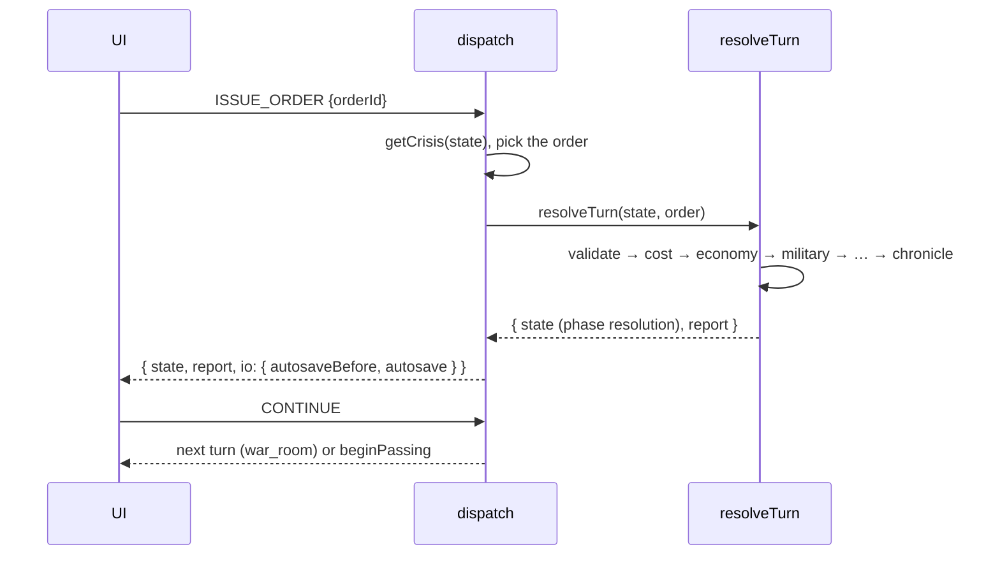
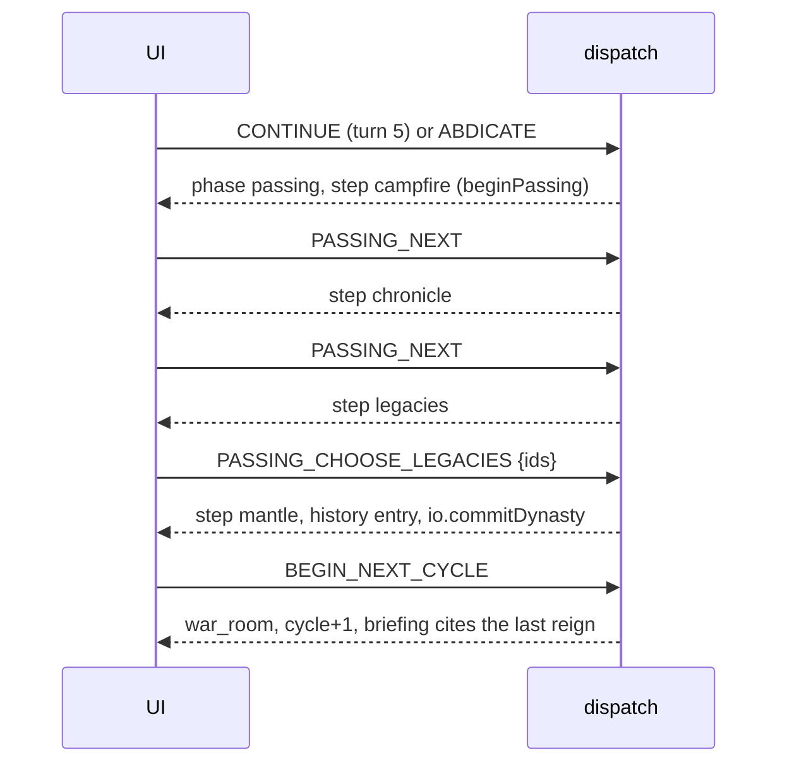

# Game-layer API reference

The developer reference for `src/game/**`: the state shape, the effects system, the controller
(actions and views), and every module's exports. Read [ARCHITECTURE.md](ARCHITECTURE.md) for the
rules and [GAME_GUIDE.md](GAME_GUIDE.md) for what the systems mean. The duel engine has its own
reference in [DUEL.md](DUEL.md); saves and the narrator are in [SAVES_AND_AI.md](SAVES_AND_AI.md).

**Contents:** [Invariants](#invariants) · [GameState](#gamestate) · [Effects](#effects) ·
[The controller](#the-controller-actionsjs) · [Views](#views-getviewstate) · [Sequences](#sequences) ·
[Module exports](#module-exports) · [How to extend](#how-to-extend)

## Invariants

1. **Effects-only mutation.** Game state changes only through `validateEffects` → `applyEffects`
   (or `commitEffects`, which does both). Controllers may replace whole sub-objects for phase
   transitions (`phase`, `expedition`, `passing`, a new cycle), but never edit numbers directly.
2. **Determinism.** No `Math.random()` or `Date.now()` in `src/game/**` outside `save/` and `ai/`.
   Randomness comes from `state.rngSeed` via `src/game/core/rng.js`, and the seed is written back.
3. **Purity.** Functions take a state and return a new one; inputs are never mutated.
4. **Write-only Chronicle.** Entries are appended; the only change an entry can receive is
   approval (`{ type: 'approval' }`), which adds `approved: true` and a `detail`.
5. **The dynasty never rolls back.** Cross-reign memory is merged above save slots
   (`src/game/save/dynasty.js`), so loading an older save cannot erase it.
6. **Zero-AI completeness.** Nothing in the game layer requires the narrator.

## GameState

Created by `createNewGame({ seed, sovereignName, startYear })` (`src/game/core/state.js`), exposed
as `newGame(options)` from `src/game/actions.js`. Plain JSON. `STATE_VERSION = 1`.

```js
{
  version: 1,
  campaignId: 'elvia-<seed base36>',
  rngSeed: 1234,                       // uint32, advanced by every random draw
  phase: 'war_room',                   // PHASES: war_room | resolution | expedition | campfire | passing
  cycle: {
    number: 1,                         // reign number
    sovereign: { name: 'Aurelian', ordinal: 'I', title: 'God-King of Elvia' },
    startYear: 412,
    activeLegacies: [],                // Legacy ids carried into this reign (≤ 2)
    cause: null,
  },
  year: 412, turn: 1, totalTurns: 0,   // turn 1..5 within the reign
  resources: { treasury, manpower, readiness, stability, unrest, intel },   // RESOURCE_BOUNDS
  factions: { iron_syndicate: Faction, frost_wargs: Faction },
  characters: { mara, vale, cassian, sparky, mika, nyra },                  // Character
  memories: [Memory],
  flags: { [key]: any },               // story flags, e.g. refugees_policy, nyra_fate, accord_sworn
  counters: { wardProjects, wargMercy, valeFunded, chronicleApproved, sparkyCare, oathsBroken,
              trialWins, duelsWon, duelsLost, retreats },                   // COUNTER_KEYS
  threads: { IRON_SYNDICATE_BORDER_CRISIS, FROST_WARG_MIGRATION, NORTHERN_REFUGEES,
             FIRST_ARCHITECTS_MYSTERY },                                     // Thread
  regions: { southern_marches: { id, name, subtitle, state, casualties, damage, monuments: [] } },
  intensity: 25,                       // NarrativeIntensity 0..100, never shown
  campfire: { cooldown: 0, history: [], offer: null },
  chronicle: [ChronicleEntry],
  decisions: [Decision],               // one per resolved turn
  voices: [{ speaker, text, cycle, turn, year }],   // newest first
  expedition: Expedition | null,       // only during phase 'expedition'
  lastExpedition: { kind, title, duels, fallen, picked, log, retreated?, cycle, turn } | null,
  trial: { lastRewardedKey, count, pending: DuelConfig | null, last: { outcome, foe, misreads, playerHpRemaining, stakes } | null },
  lastResolution: Report | null,       // what the Resolution screen shows
  passing: { cause, step, earned, chosen, startedAtTurn } | null,
  history: [HistoryEntry],             // one per completed reign (see cycleHistoryEntry)
}
```

| Shape | Fields |
|---|---|
| **Character** | `id, name, short, role, status` (`active, unmet, met, retired, dead, captured, released, recruited, killed, departed`), `companion, age, generation, rel: { trust, respect, affection (−100..100), resentment, fear (0..100) }` |
| **Faction** | `id, name, leader, attitude (−100..100), tension (0..100), memory: { liberator, conqueror, oathbreaker, peacemaker }` |
| **Thread** | `id, title, status (active/dormant/resolved), stage, visibility (hidden/rumored/known), urgency (0..100), involvedCharacters, involvedFactions, lastAdvancedTurn, generational, flags` |
| **Memory** | `id, characterId, eventId, cycle, turn, year, type (e.g. inherited), description, emotionalWeight, sentiment (−1..1), permanent, tags` |
| **ChronicleEntry** | `id ('c<cycle>-t<turn>-<n>'), cycle, turn, year, title, text, kind, tags, approved, detail?` |
| **Decision** | `id, cycle, turn, year, season, crisisId, orderId, category, label, custom: { text, actions } | null, underfunded` |
| **HistoryEntry** | `cycle, sovereign, sovereignName, sovereignOrdinal, startYear, endYear, cause, legacies, highlights, keys: { refugees_policy, mika_family, child_name, nyra_fate, architect_studied, accord, era_policy, border_outcome, warg_mercy, duels_won, duels_lost }, civilization: { [factionId]: label }` |

Constants in `state.js`: `TURNS_PER_CYCLE`, `SEASONS`, `RESOURCE_KEYS`, `HUD_KEYS`,
`RESOURCE_BOUNDS`, `REL_KEYS`, `REL_BOUNDS`, `CIV_MEMORY_KEYS`, `REGION_STATES`,
`THREAD_STATUSES`, `THREAD_VISIBILITY`, `PHASES`, `CHARACTER_IDS`, `FACTION_IDS`, `THREAD_IDS`,
`COUNTER_KEYS`, `STATE_VERSION`. Helpers: `seasonOf(turn)`, `seasonLabel(state)` ("Spring 412
E.R."), `sovereignTitle(state)` ("Aurelian I"), `clamp(value, [min, max])`.

## Effects

`src/game/core/effects.js`. An effect is a small object; content, the resolver, duels and the
narrator all produce them.

```js
{ type:'resource', key, delta }
{ type:'faction', faction, attitude?, tension?, memory?: { liberator?, conqueror?, oathbreaker?, peacemaker? } }
{ type:'relationship', character, trust?, respect?, affection?, resentment?, fear? }
{ type:'memory', character, eventId, description, emotionalWeight?, sentiment?, permanent?, tags?, kind? }
{ type:'flag', key, value }
{ type:'counter', key, delta }                       // key ∈ COUNTER_KEYS
{ type:'thread', thread, stage?, setStage?, urgency?, status?, visibility?, flags? }
{ type:'region', region, state?, casualties?, damage?, monument?: { id, title, text } }
{ type:'intensity', delta, reason? }
{ type:'chronicle', title, text, kind?, tags? }      // appended; id/cycle/turn/year added on apply
{ type:'character', character, status?, role?, name?, age? }
{ type:'voice', speaker, text }
{ type:'approval', entry, detail? }                  // approve a Chronicle entry (never rewrites it)
```

**`validateEffects(effects, state, { source = 'sim' })`** → `{ valid, rejected: [{ effect,
reason }], repaired }`. It rejects unknown types, unknown ids (resource keys, factions,
characters, threads, statuses), non-numeric deltas, empty text, and already-approved entries. It
**repairs** rather than rejects when it can: magnitudes are clamped to caps and long text is
truncated (each repair is listed). Caps per effect:

| | resource deltas | relationship (each key) | faction attitude/tension/memory | memory `emotionalWeight` | intensity |
|---|---|---|---|---|---|
| `source: 'sim'` (`SIM_CAPS`) | treasury/manpower ±5000, others ±60 | ±60 | ±60 | 1–10 | ±60 |
| `source: 'ai'` (`AI_CAPS`) | treasury/manpower ±150, others ±4 | ±5 | ±5 | 1–4 | ±5 |

Simulation counters move at most ±5, thread stages ±5 and urgency ±80 per effect.

With `source: 'ai'` only `resource, relationship, faction, memory, intensity, voice` are allowed
(`AI_ALLOWED_TYPES`); anything structural is rejected.

**`applyEffects(state, validEffects)`** → new state (copy-on-write per touched key, values
clamped to bounds). **`commitEffects(state, effects, options)`** → `{ state, report }`.

Content helpers in `src/game/content/effectHelpers.js`: `res(key, delta)`, `rel(character,
deltas)`, `fac(faction, { attitude, tension, memory })`, `flag(key, value)`, `counter(key,
delta=1)`, `thread(id, fields)`, `region(fields)`, `heat(delta, reason)`, `chron(title, text,
kind, tags)`, `mem(character, eventId, description, weight, sentiment, extra)`, `voice(speaker,
text)`, `character(id, fields)`, `hasLegacy(state, id)`, and ids `SYN`, `WARGS`, `T_SYN`,
`T_WARGS`, `T_REFUGEES`, `T_MYSTERY`.

## The controller (`actions.js`)

`dispatch(state, action)` → `{ state, io, error, report? }`. On error the state is unchanged and
`error` is a sentence for the player. `io` asks the caller (the UI's `GameProvider`) to do side
effects: `autosaveBefore` (save the *previous* state under that reason), `autosave` (save the new
state), `commitDynasty` (merge the reign into the dynasty record).

| Action | Payload | Allowed in | Result | io |
|---|---|---|---|---|
| `ISSUE_ORDER` | `{ orderId: 'A'..'E' }` | war_room | resolves the turn → resolution; `report` | before/after_resolution |
| `ISSUE_CUSTOM_ORDER` | `{ text, interpretation? }` | war_room | parses (or uses an `understood` interpretation), blends, resolves | before/after_resolution |
| `CONTINUE` | — | resolution | next turn → war_room; after turn 5 → passing (era or fall) | after_resolution when entering the Passing |
| `BEGIN_DEPLOYMENT` | `{ kind: 'march'|'skirmish'|'last_stand' }` | resolution (if offered) | → expedition | expedition |
| `EXPEDITION_CHOICE` | `{ choiceId }` | expedition | talk: stay; advance: next beat (or finish); duel: sets `expedition.pendingDuel` | expedition when the march ends |
| `EXPEDITION_DUEL_COMPLETE` | `{ result: DuelResult }` | expedition with a pending duel | outcome effects, casualties, `after_victory/after_defeat/after_retreat` | expedition |
| `EXPEDITION_RETREAT` | — | expedition when `canRetreat` | retreat effects → resolution | expedition |
| `START_CAMPFIRE` | — | resolution when a campfire is offered | → campfire | — |
| `CAMPFIRE_COMPLETE` | `{ mode: 'enter'|'short'|'skip', responseId? }` | campfire | settle intensity (+ scene effects) → resolution | after_campfire |
| `TRIAL_START` | `{ archetypeId }` | war_room | `trial.pending = trialConfig(...)` | — |
| `TRIAL_CANCEL` | — | any | clears `trial.pending` | — |
| `TRIAL_COMPLETE` | `{ result }` | with `trial.pending` | rewards (once per turn), `trial.last` | — |
| `APPROVE_CHRONICLE` | `{ entryId }` | any (this reign's entries) | approval + `chronicleApproved` +1 | — |
| `ABDICATE` | — | war_room, resolution | → passing (abdication) | after_resolution |
| `PASSING_NEXT` | — | passing (campfire, chronicle steps) | next step | — |
| `PASSING_CHOOSE_LEGACIES` | `{ ids: string[] }` (0–2 earned) | passing, step legacies | history entry, step mantle | commitDynasty |
| `BEGIN_NEXT_CYCLE` | — | passing, step mantle | the Return → war_room, cycle + 1 | cycle_start + commitDynasty |
| `APPLY_AI_EFFECTS` | `{ effects }` | any | up to 3 narrator proposals, validated with `source: 'ai'` | — |

Other exports: `ACTION_TYPES`, `TRIAL_FOES`, `trialConfig(state, archetypeId)`,
`trialKey(state)`, `availableCampfire(state)`, `approvalDetail(state, entry)`,
`endTurn(state)`, `newGame(options)`, `getView(state)`.

## Views (`getView(state)`)

A pure read for the UI. Common fields: `{ phase, season, sovereign, cycle, turn, turnsPerCycle }`.

- **war_room**: `crisis` (`getCrisis(state)`: `{ id, title, location, season, briefing: string[],
  conflict, advisors: [{ id, line }], orders: [Order], era?, borderOutcome? }` where an Order is
  `{ id, category, categoryName, label, text, cost: { treasury, manpower }, affordable, reactions,
  warning?, locked?, effects, outcome, voices }`), `trial`, `trialRewardAvailable`. The UI must not
  show `effects` or `outcome` before the order is chosen.
- **resolution**: `report` (= `state.lastResolution`: `{ cycle, turn, season, orderId, orderLabel,
  category, custom, underfunded, outcome, voices, events, resourceDeltas, relationshipShifts:
  [{ character, from, to }]` (tier words), `factionShifts: [{ faction, from: { attitude, tension },
  to }]` (label words), `regionBefore, regionAfter, newMemories, newChronicle, pipeline, rejected }`),
  `expedition` (the march that ended **this turn**, else null), `deployments`, `campfire` (offer or
  null), `isFinalTurn`.
- **expedition**: `expedition` (state.expedition plus `lastDuel`), `beat` (`getBeat`: `{ id, title,
  subtitle, scene: { beat, timeOfDay }, speaker?, text, choices: [{ id, kind, label, hint?, warning?,
  effects, result, duel? }] }`), `canRetreat`.
- **campfire**: `offer`, `scene` (enter mode), `shortScene`.
- **passing**: `passing`, `farewells`, `readback` (`{ sovereign, years, lines, verdicts }`),
  `legacies` (`[{ id, name, earn, effect, cost, earned, progress }]`).

## Sequences



```mermaid
sequenceDiagram
  participant UI
  participant C as dispatch
  participant D as DuelScreen / engine
  UI->>C: BEGIN_DEPLOYMENT {kind:'march'}
  loop each beat
    UI->>C: EXPEDITION_CHOICE {choiceId}
  end
  C-->>UI: expedition.pendingDuel = DuelConfig
  UI->>D: createDuel(config); stepDuel(...) every frame
  D-->>UI: getDuelResult(duel)
  UI->>C: EXPEDITION_DUEL_COMPLETE {result}
  C-->>UI: after_victory / after_defeat (rematch offered) / after_retreat
  UI->>C: EXPEDITION_CHOICE (advance to camp) → finishExpedition → campfire or resolution
```



## Module exports

| Module | Exports |
|---|---|
| `core/state.js` | `createNewGame`, `createCharacters`, `createFactions`, `createThreads`, `createRegions`, `createCounters`, `seasonOf`, `seasonLabel`, `sovereignTitle`, `clamp`, constants listed above |
| `core/effects.js` | `EFFECT_TYPES`, `validateEffects`, `applyEffects`, `commitEffects` |
| `core/rng.js` | `hashString(str)`, `rngStep(seed)`, `makeRng(seed)` (`next, int, pick, chance`, `.seed`), `withRng(state, fn)` → `[value, nextState]` |
| `core/relationships.js` | `TIERS`, `relationshipLabel`, `tierIndex`, `atLeast`, `relationshipNotes`, `CIV_LABELS`, `civilizationLabel`, `attitudeLabel`, `tensionLabel` |
| `sim/resolver.js` | `PIPELINE`, `resolveTurn(state, order, { custom })`, `scaleEffects(effects, weight)`, `phaseOfEffect(effect)` |
| `sim/orderParser.js` | `CATEGORIES`, `parseOrder(text)` → `{ actions, summary, confidence, understood }`, `buildCustomOrder(crisis, interpretation, text)` |
| `sim/threads.js` | `passiveThreadEffects(state, addressed)`, `threadsTouchedBy(effects)`, `stageOf(thread)` |
| `sim/intensity.js` | `INTENSITY`, `CAMPFIRE_THRESHOLD`, `CAMPFIRE_COOLDOWN_TURNS`, `intensityEffect`, `stabilizationEffects`, `campfireEligibility` |
| `content/crises.js` | `getCrisis(state)`, `historyCallbacks(state)`, `borderOutcome(state)`, `crossingLeader`, `CATEGORY_NAMES` |
| `content/expedition.js` | `EXPEDITION_KINDS`, `createExpedition`, `getBeat`, `currentBeatId`, `canRetreat`, `deploymentOffers`, `deploymentOffer`, `duelConfig`, `duelOutcomeEffects`, `retreatEffects`, `casualtiesFor` |
| `content/campfire.js` | `CAMPFIRE_MODES`, `campfireOffer`, `getCampfireScene(state, mode)`, `campfireCompletionEffects`, `campfireCooldown` |
| `content/legacies.js` | `LEGACIES`, `LEGACY_IDS`, `MAX_LEGACIES`, `legacyStatus`, `earnedLegacies`, `validateLegacyChoice`, `legacyName` |
| `content/names.js` | `soldierName`, `fallenList`, `incarnationName`, `familyName`, `givenName` |
| `cycle/passing.js` | `PASSING_STEPS`, `CYCLE_CAUSES`, `beginPassing`, `advancePassing`, `passingFarewells`, `chronicleReadback`, `passingLegacyOptions`, `chooseLegacies`, `cycleHistoryEntry`, `beginNextCycle`, `earnedLegacies` |
| `duel/engine.js` | `createDuel`, `stepDuel`, `getDuelResult`, `getTelegraph`, `isDuelOver`, `guardActive`, `correctDodgeSides`, `telegraphColorFor`, `drillProgress`, `DRILL_STATS`, `STEP_MS`, `TUNING` (see [DUEL.md](DUEL.md)) |
| `duel/drills.js` | `DRILLS`, `DRILL_IDS`, `drillConfig(id, seed)`, `SPARRING`, `sparringConfig(archetypeId, seed, { mirror })`, `YARD_FOES` (the training yard) |
| `dev/scenarios.js` | `SCENARIOS`, `buildScenario(name)` |

Exact export lists can always be printed with
`node -e "import('./src/game/actions.js').then(m => console.log(Object.keys(m)))"`.

## How to extend

**A new action.** Write a handler `(state, payload) => ok(next, { io })` or `fail(state, msg)` in
`actions.js`, check the phase with `requirePhase`, change state through `commit(...)`, add it to
`HANDLERS` and `ACTION_TYPES`, extend `getView` if the UI needs new data, and document it in this
file and [UI.md](UI.md). Test it in `src/game/playthrough.test.js` or a new test next to it.

**A new effect type.** Add it to `EFFECT_TYPES`, validate it in `validateOne` (reject unknown ids,
clamp magnitudes, decide whether `source: 'ai'` may use it), apply it in `applyEffects`, route it
in `phaseOfEffect` (resolver), and add a test. If saved state gains a field, add a migration.

**A new phase.** Add it to `PHASES`, give `getView` a case, add the transitions, route the screen
in `src/App.jsx`, add a dev scenario in `src/game/dev/scenarios.js` (+ its expected phase in
`scenarios.test.js`), and update this doc, [UI.md](UI.md) and the e2e playthrough.

**State shape changes** need `STATE_VERSION` + a migration in `src/game/save/migrate.js`
(see [SAVES_AND_AI.md](SAVES_AND_AI.md)).
